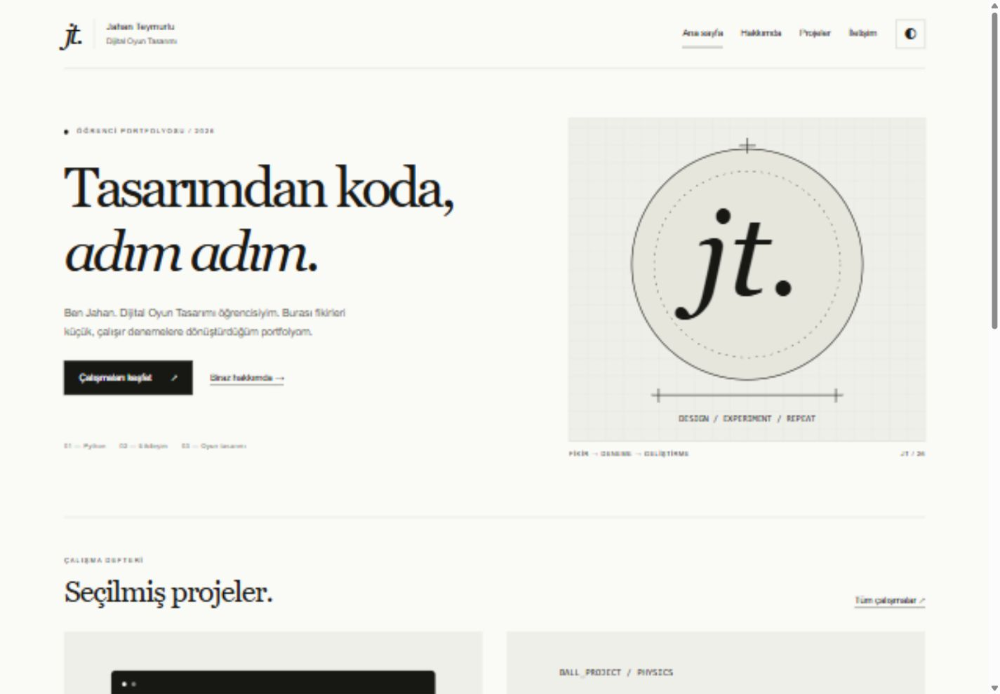
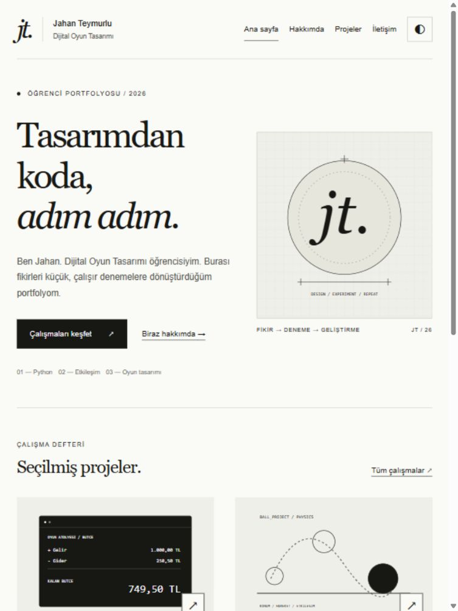
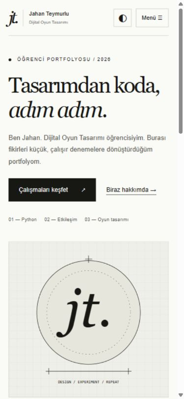

# Kişisel Web Portfolyosu - Süreç Raporu

Jahan Teymurlu | Dijital Oyun Tasarımı | GEP1316 | 06.11.2026

## 1. Tasarım kararları

Hedef kitle, öğrencinin çalışmalarını görmek isteyen öğretmen ve oyun tasarımıyla ilgilenen ziyaretçiler. Siyah-beyaz palet, proje görsellerinin önüne geçmiyor. Başlıklarda Georgia/Times New Roman, metinde Arial kullanıldı; fontlar cihazdan geliyor. Dört ana sayfa aynı gezintiyi, altbilgiyi ve CSS/JS dosyalarını paylaşıyor. Masaüstünde iki sütunlu proje düzeni, telefonda tek sütuna dönüşüyor. JT avatarı ve şemalar yerel SVG; gerçek oyun görüntüsü gibi sunulmuyor.

Yayında: https://anpunabis.github.io/gep1316-portfolyo/ — 06.11.2026 tarihinde tarayıcıda doğrulandı. Mevcut Unity depolarının GEP1316 Ödev 1–6 karşılıkları doğrulanmadı. Altı geliştirme istemi ayrı öğrenci mesajları değildir; kişisel prompt günlüğü öğrenci kontrolü bekler.

## 2. YZ ile çalışma

1. Site yapısı: Jahan Teymurlu için HTML/CSS/JS ile ana sayfa, hakkımda, projeler ve iletişim sayfalarını oluştur.

Yanıt: Dört ana sayfa ve yedi ayrıntı sayfası hazırlandı.

Karar: Kabul: ortak gezinti ve ortak dosyalar sağlandı.

2. Görsel düzen: Dijital Oyun Tasarımı alanına uygun, sade ve duyarlı bir portfolyo tasarla.

Yanıt: Yerel SVG monogram ve şemalar, serif başlıklar, siyah-beyaz palet kullanıldı.

Karar: Düzenleme: stok fotoğraf yerine kimlik uydurmayan JT avatarı seçildi.

3. Proje kaynakları: Anpunabis profilindeki gerçek projeleri doğrula; yeni demoları eski ödev gibi sunma.

Yanıt: Üç mevcut GitHub deposu incelendi; üç yeni demo ayrıca etiketlendi.

Karar: Red: doğrulanmayan oyun özellikleri ve GEP1316 ödev numaraları eklenmedi.

4. Etkileşim ve gizlilik: Tema, menü, filtre/arama ve doğrulamalı iletişim formu ekle; formun davranışını açıkla.

Yanıt: Form yalnız taslak üretir; veri saklamaz. Kopyalama ve güvenli metin çıktısı eklendi.

Karar: Düzenleme: gönderilmiş mesaj izlenimi verilmedi; textContent ve form-action none kullanıldı.

5. Erişilebilirlik düzeltmesi: Mobil menüyü klavye ile aç, Tab ve Escape davranışını test et.

Yanıt: İlk sürümde Tab menü bağlantılarını atladı. Açılışta ilk bağlantıya focus eklendi.

Karar: İlk hali reddet/düzelt: düzeltme sonrası odak gezintiye geçti, Escape düğmeye döndürdü.

6. Kanıt ve yayın: Üç ekran boyutunu test et, belgeleri hazırla ve kullanıcı girişinden sonra GitHub Pages ile yayınla.

Yanıt: 33 yerleşim ölçümü ve 3 sayfalık rapor hazırlandı. Site Anpunabis/gep1316-portfolyo deposundan yayınlandı.

Karar: Kabul: canlı sayfa ve etkileşimleri tarayıcıda doğrulandı; gerçek adres README belgesine eklendi.

## 3. Test ve erişilebilirlik

# Testler ve erişilebilirlik

6 Kasım 2026; yerel tarayıcı önizlemesi. Teknik kontroller asistan tarafından yapıldı.

| Test | Beklenen | Gerçek |
| --- | --- | --- |
| 11 sayfa × 3 ekran | Taşma yok; 1 h1; etiket ve alt metin var | 33 kontrolde geçti |
| Mobil menü + Escape | Odak bağlantıya; kapanınca düğmeye | Düzeltmeden sonra geçti |
| Tema değiştir / yenile | Seçim korunur | dark değeri korundu |
| Unity filtresi | 3 proje görünür | 3 proje |
| BÜTÇE araması / zzzzzz | 1 proje / boş sonuç mesajı | 1 ve 0 sonuç |
| Boş form | İlk hataya odak; taslak yok | contact-name odağı |
| A / hatali / kısa | Üç alan da hatalı | 3 aria-invalid=true |
| Geçerli form + HTML metni | Taslak var; HTML çalışmaz | 0 enjekte img öğesi |
| Metni kopyala | Kopyalandı bilgisi | Panoya kopyalandı |
| Anlatı / üç son | Üç farklı son ve yeniden başlatma | Üçü de görüldü |
| 20 hasar / 0.5 sn / 100 can | 40 DPS; 5 vuruş; 2 sn | 40 / 5 / 2 sn |
| Can 20 / aralık 0 | 0 sn / hata | 0 sn; hatalı aralık reddedildi |
| Ustalık aşaması | İlgili tasarım notu | Ustalık metni |
| İçeriğe geç bağlantısı | main odağı | icerik odağı |
| Yerel dosya bağlantıları | Dosya ve bölüm hedefleri var | Tümü geçti |

## Erişilebilirlik ve gizlilik kontrol listesi

- **Anlamsal yapı:** 11 sayfada header/nav/main/footer ve tek h1 kontrol edildi.
- **Alt metin:** Görsellerde açıklama var; temsili çizimler ayrıca belirtildi.
- **Form etiketi:** Her input/textarea için label var; hatalar aria-describedby ile bağlı.
- **Klavye:** İçeriğe geç, mobil menü/ Escape ve anlatı düğmeleri denendi. Tüm olası klavye rotaları elle test edilmedi.
- **Kontrast:** Açık tema: metin 17.18:1, ikincil 7.18:1. Koyu tema: 16.39:1 ve 9.08:1. Normal metin 4.5:1 eşiğini geçiyor.
- **Hareket:** prefers-reduced-motion kuralı var; animasyonlar kapatılır.
- **Gizlilik:** Form yalnız bellekte taslak; kalıcı form verisi ve takip betiği yok. Tema tercihi localStorage kullanır.
- **Güvenli metin:** HTML benzeri girdi textContent ile aynen gösterildi; DOM içinde img oluşmadı.
- **Dış bağlantılar:** Yeni sekme bağlantılarında noopener/noreferrer var. Üç mevcut depo tarayıcıda doğrulandı.
- **Kapsam sınırı:** Ekran okuyucu donanımı ve gerçek telefon kullanılmadı; testler tarayıcı viewport ölçülerinde yapıldı.

## Gerçek ekran görüntüleri

Ham ölçümler: belgeler/yerlesim-testleri.json ve belgeler/statik-kontrol.json. Yayımlanmamış hedef repo/canlı site bağlantıları dış bağlantı başarısı olarak sayılmadı.

## 4. Yansıtma (269 kelime)

Dönem başında kodlama bilgim zaten vardı. Bu yüzden derste karşılaştığım konular bana tamamen yabancı gelmedi ve kodlama kısmını çok zor bulmadım. Yine de bu dersin bana çok şey öğrettiğini düşünüyorum. Bu portfolyoyu hazırlarken de yalnızca bir programın çalışmasının değil, nasıl sunulduğunun ve başkasının onu nasıl kullanacağının önemli olduğunu ele aldım. Bir projeyi anlatmak, dosyalarını düzenlemek ve yaptığı işi açıkça göstermek de çalışmanın bir parçası.

İlk ara değerlendirmede oyun ekibinin bütçesini takip eden bir Python uygulaması hazırlandı. İkinci ödevde bu uygulamayı bir web portfolyosunun içine yerleştirdik. GitHub profilimdeki mevcut projeler de ayrı kartlarla gösterildi. Projelerin kaynaklarına ulaşılabilmesi ve yeni hazırlanan denemelerin eski çalışmalarla karıştırılmaması benim için önemli. Böylece site yalnızca bir tanıtım sayfası değil, çalışmaların nerede bulunabileceğini gösteren bir yer haline geliyor.

Bu süreçte Codex'ten kod, tasarım, test ve belge hazırlığında kapsamlı destek aldım. Hazırlanan dosyaların nasıl açılacağını ve teslimde nelerin gerektiğini sordum. Teknik kontrolleri asistan yaptı. Örneğin mobil menünün ilk halinde klavye odağı bağlantılara geçmiyordu. Bu eksiklik test sırasında bulunup düzeltildi. Bu durum, çalışan bir düğmenin her kullanıcı için rahat kullanılabilir olduğu anlamına gelmediğini gösteriyor.

YZ ile çalışmanın yararı, bir fikrin ilk halini daha hızlı görebilmek ve farklı çözümleri karşılaştırabilmek. Sınırı ise kodun doğruluğunu, içerikteki iddiaları ve kendi öğrenmemi benim yerime garanti edememesi. Ortaya çıkan işi okuyup anlamam, kişisel anlatımın bana uyduğunu kontrol etmem ve açıklayamadığım yerleri öğrenmem gerekiyor.

Gelecekte bu portfolyoya gerçek oyun görüntüleri, oynanabilir prototipler ve daha ayrıntılı tasarım notları eklemek isterim. Her projede yalnız sonucu değil, karşılaştığım bir sorunu ve nasıl çözdüğümü de anlatabilirim. Mevcut kodlama bilgimi oyun tasarımıyla birleştirerek bütçe, seviye akışı ve oyun dengesi gibi konular için küçük araçlar geliştirmek, bu çalışmanın devamı olabilir.

## 5. YZ beyanı

Araç: OpenAI Codex. Amaç: site/kod, tasarım, test ve belge hazırlığı. Ad: Jahan Teymurlu. Tarih: 06.11.2026.

Öğrencinin incelemesinden sonra onaylayacağı metin: Yapay zekâ tarafından üretilen içeriği gözden geçirdiğimi, gerekli düzeltmeleri yaptığımı ve teslim ettiğim çalışmanın doğruluğundan ve akademik dürüstlüğünden sorumlu olduğumu beyan ederim.

OpenAI. (2026). *Codex* [Yapay zekâ destekli kodlama aracı]. https://openai.com/codex/
