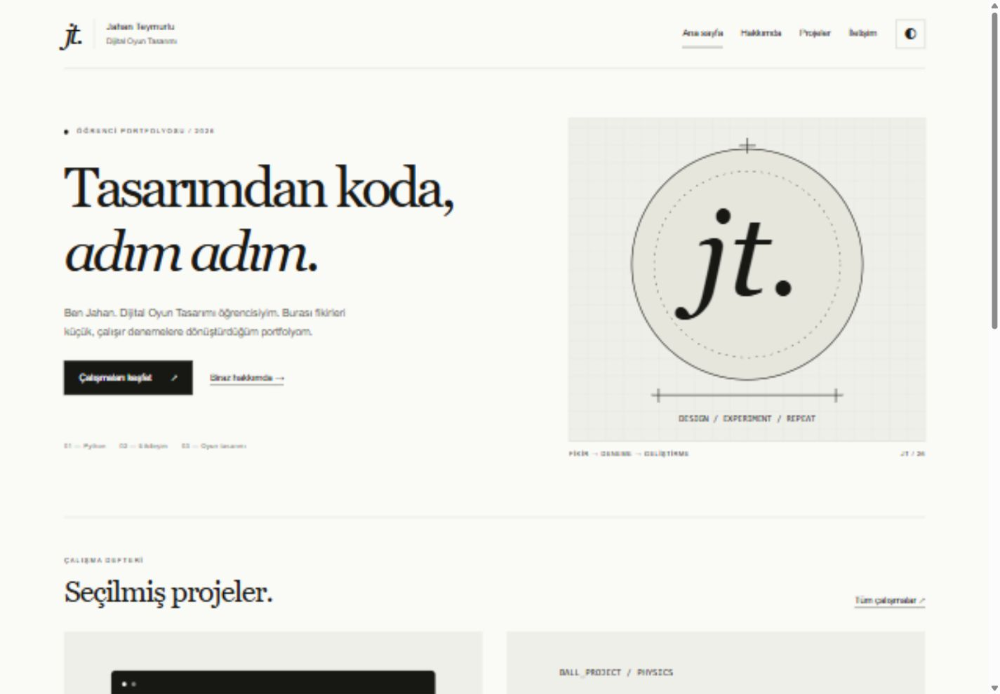
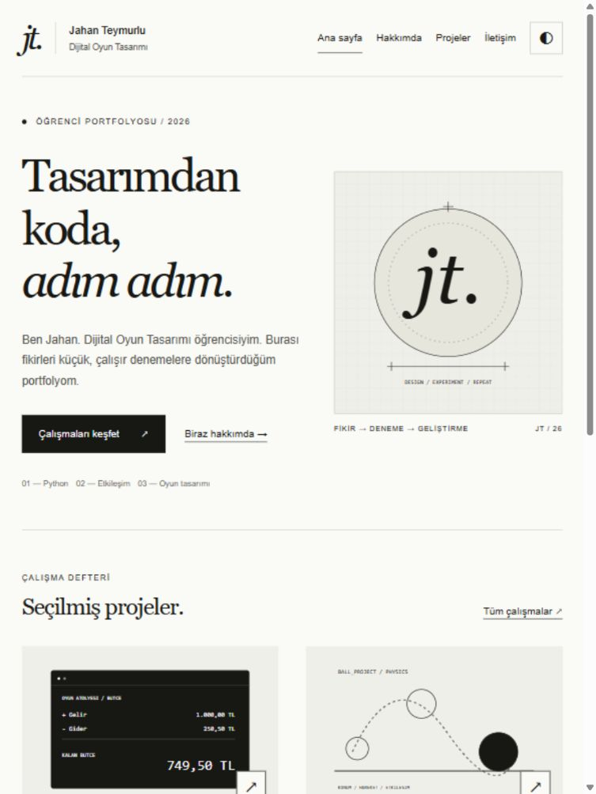
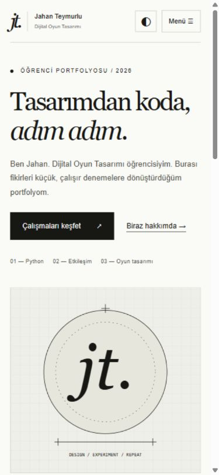

# Testler ve erişilebilirlik

6 Kasım 2026; yerel tarayıcı önizlemesi. Teknik kontroller asistan tarafından yapıldı.

| Test | Beklenen | Gerçek |
| --- | --- | --- |
| 11 sayfa × 3 ekran | Taşma yok; 1 h1; etiket ve alt metin var | 33 kontrolde geçti |
| Mobil menü + Escape | Odak bağlantıya; kapanınca düğmeye | Düzeltmeden sonra geçti |
| Tema değiştir / yenile | Seçim korunur | dark değeri korundu |
| Unity filtresi | 3 proje görünür | 3 proje |
| BÜTÇE araması / zzzzzz | 1 proje / boş sonuç mesajı | 1 ve 0 sonuç |
| Boş form | İlk hataya odak; taslak yok | contact-name odağı |
| A / hatali / kısa | Üç alan da hatalı | 3 aria-invalid=true |
| Geçerli form + HTML metni | Taslak var; HTML çalışmaz | 0 enjekte img öğesi |
| Metni kopyala | Kopyalandı bilgisi | Panoya kopyalandı |
| Anlatı / üç son | Üç farklı son ve yeniden başlatma | Üçü de görüldü |
| 20 hasar / 0.5 sn / 100 can | 40 DPS; 5 vuruş; 2 sn | 40 / 5 / 2 sn |
| Can 20 / aralık 0 | 0 sn / hata | 0 sn; hatalı aralık reddedildi |
| Ustalık aşaması | İlgili tasarım notu | Ustalık metni |
| İçeriğe geç bağlantısı | main odağı | icerik odağı |
| Yerel dosya bağlantıları | Dosya ve bölüm hedefleri var | Tümü geçti |

## Erişilebilirlik ve gizlilik kontrol listesi

- **Anlamsal yapı:** 11 sayfada header/nav/main/footer ve tek h1 kontrol edildi.
- **Alt metin:** Görsellerde açıklama var; temsili çizimler ayrıca belirtildi.
- **Form etiketi:** Her input/textarea için label var; hatalar aria-describedby ile bağlı.
- **Klavye:** İçeriğe geç, mobil menü/ Escape ve anlatı düğmeleri denendi. Tüm olası klavye rotaları elle test edilmedi.
- **Kontrast:** Açık tema: metin 17.18:1, ikincil 7.18:1. Koyu tema: 16.39:1 ve 9.08:1. Normal metin 4.5:1 eşiğini geçiyor.
- **Hareket:** prefers-reduced-motion kuralı var; animasyonlar kapatılır.
- **Gizlilik:** Form yalnız bellekte taslak; kalıcı form verisi ve takip betiği yok. Tema tercihi localStorage kullanır.
- **Güvenli metin:** HTML benzeri girdi textContent ile aynen gösterildi; DOM içinde img oluşmadı.
- **Dış bağlantılar:** Yeni sekme bağlantılarında noopener/noreferrer var. Üç mevcut depo tarayıcıda doğrulandı.
- **Kapsam sınırı:** Ekran okuyucu donanımı ve gerçek telefon kullanılmadı; testler tarayıcı viewport ölçülerinde yapıldı.

## Gerçek ekran görüntüleri

Ham ölçümler: belgeler/yerlesim-testleri.json ve belgeler/statik-kontrol.json. Yayımlanmamış hedef repo/canlı site bağlantıları dış bağlantı başarısı olarak sayılmadı.
